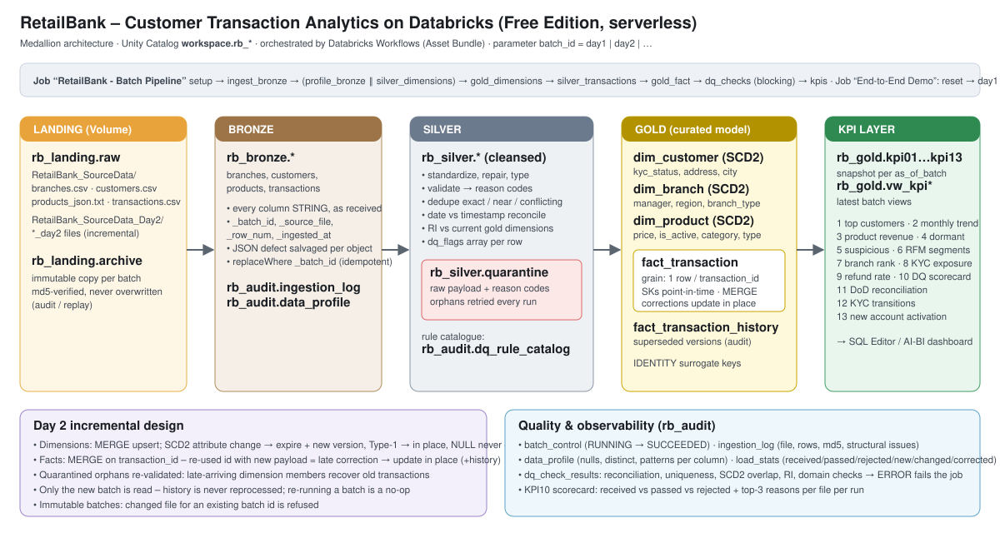

# RetailBank – Customer Transaction Analytics (Databricks)

End-to-end, re-runnable medallion pipeline on **Databricks (Free Edition, serverless, Unity Catalog)** that turns the
deliberately dirty RetailBank feeds into a curated star schema and the 13 KPIs of the brief, and absorbs the Day 2
incremental drop (new records, SCD changes, late transaction corrections) without reprocessing history.



## Results at a glance (end-to-end run: reset → Day 1 → Day 2)

| | Day 1 | Day 2 |
|---|---|---|
| Records received (all files) | 1,413 | 266 |
| Passed / rejected | 1,175 / 238 | 215 / 51 |
| Transactions pass rate | 76.8 % | 74.4 % |
| Dimension changes | 99 branches, 246 customers, 108 products created | +1 branch, +22 customers, +9 products; **SCD2 new versions: 1 branch, 14 customers, 9 products** |
| Late corrections | – | **10 applied in place** (status flips), history kept; 2 superseded quarantined rows |
| Recovered from quarantine | – | **6** Day-1 transactions on P299 (late-arriving product) |
| Fact rows / distinct ids | 722 / 722 | 866 / 866 (no double counting) |
| Blocking DQ checks failed | 0 | 0 (2 informational warnings each day) |

KPI 12: 9 customers Pending → Verified · KPI 13: 5 accounts transacted for the first time, 22 newly onboarded customers not yet transacting ·
KPI 11: top-5 customers changed (C035 dropped from #1 because its T0793 was corrected Success → Failed).

**Workspace locations:** notebooks `Workspace › Users › <you> › RetailBank_Pipeline › files › src` · jobs *RetailBank - Batch Pipeline (one day)*
and *RetailBank - End-to-End Demo* · dashboard *RetailBank - KPI Dashboard* (Dashboards) · tables `Catalog › workspace › rb_*`.

## Frontend – Streamlit Databricks App

`app/` is a Streamlit app (deployed as the Databricks App **retailbank-kpi** by the bundle) that follows the
*RetailBank KPI Dashboard* Figma design: dark/light glass theme, icon sidebar and 8 screens –
**Overview · Transactions & Branches · Risk & Customers · Data Quality · Day 1 vs Day 2 · Pipeline runs · Customers · Reports & exports** (+ Settings).

* Reads `workspace.rb_gold / rb_silver / rb_audit` live through the SQL warehouse (app resource `sql-warehouse`), cached 5 min.
* Batch selector (DAY1 / DAY2) switches every KPI snapshot; Day 1 vs Day 2 shows KPI 11–13, SCD2 history, late corrections and recovered rows.
* *Pipeline runs* lists job runs and can trigger the batch job (app resource `pipeline-job`, CAN_MANAGE_RUN).
* *Reports & exports* downloads every KPI table, the quarantine, DQ checks and profile as CSV.

```bash
databricks bundle deploy && databricks bundle run rb_kpi_app
# one-time: let the app's service principal read the tables
#   GRANT USE CATALOG ON CATALOG workspace TO `<app-sp-client-id>`;
#   GRANT USE SCHEMA, SELECT ON SCHEMA workspace.rb_gold|rb_silver|rb_audit|rb_bronze TO `<app-sp-client-id>`;
```

Local run: `DATABRICKS_CONFIG_PROFILE=<profile> DATABRICKS_WAREHOUSE_ID=<id> streamlit run app/app.py`.

## Platform choice & service mapping

| Capability | Used here | Why |
|---|---|---|
| Landing / raw storage | **Unity Catalog Volume** `workspace.rb_landing.raw` (+ immutable `archive` Volume) | governed file storage, POSIX access from notebooks, no external cloud account needed |
| Processing | **PySpark + Spark SQL notebooks on serverless compute** | one engine for ingestion, DQ, modelling and KPIs |
| Curated warehouse | **Delta tables** in UC schemas `rb_bronze / rb_silver / rb_gold / rb_audit` | ACID `MERGE` (SCD2, upserts), time travel, `replaceWhere` for idempotent batch slices |
| Orchestration | **Databricks Workflows**, defined as code in a **Databricks Asset Bundle** (`databricks.yml`) | task DAG, job parameters (`batch_id`), retries; deployable from Git |
| Data quality | Rule-based cleansing + `rb_silver.quarantine` + automated assertions (`07_dq_checks`) that **fail the job** | quality gates are part of the pipeline, not ad-hoc |
| Consumption | KPI tables + `vw_kpi*` views → SQL Editor / AI-BI dashboards; `09_demo_report` notebook | |

> On AWS/Azure/GCP the same design maps to S3/ADLS/GCS + Databricks or Glue/Dataproc; nothing here is Free-Edition specific
> except the default catalog name (`workspace`), which is a bundle variable.

## Repository layout

```
databricks.yml                 # Asset Bundle: 2 jobs (batch pipeline, end-to-end demo)
src/includes/common.py         # config, batch registry, parsing helpers, quarantine/metrics writers, SCD2 MERGE
src/00_setup.py                # schemas, volumes, audit tables, gold DDL, DQ rule catalogue
src/01_ingest_bronze.py        # archive files immutably, load as STRING + metadata, JSON salvage
src/02_profile_bronze.py       # column profiling -> rb_audit.data_profile
src/03_silver_dimensions.py    # cleanse/validate/dedupe branches, customers, products
src/04_gold_dimensions.py      # SCD2 upserts into dim_customer / dim_branch / dim_product
src/05_silver_transactions.py  # cleanse/validate/dedupe transactions, RI, quarantine retry
src/06_gold_fact.py            # MERGE into fact_transaction (late corrections) + history
src/07_dq_checks.py            # automated assertions -> rb_audit.dq_check_results (blocking)
src/08_kpis.py                 # KPI 1-13 tables + latest views
src/09_demo_report.py          # read-only walkthrough for the demo
src/99_reset.py                # drop all pipeline tables (landing files kept) for a clean replay
src/dashboards/retailbank_kpis.lvdash.json  # AI/BI dashboard (deployed by the bundle)
app/app.py, app/data.py, app/ui.py    # Streamlit Databricks App (Figma design), app.yaml + requirements.txt
docs/architecture.svg, docs/data_quality_report.md, docs/screenshots/ (app pages)
data/RetailBank_SourceData[_Day2]/   # the raw source drops exactly as received (synthetic data)
```

## Setup & run

Prerequisites: Databricks CLI ≥ 0.2xx authenticated to the workspace (`databricks auth login --host <workspace-url>`).

```bash
# 1. land the source drops in the Volume (one folder per batch, files exactly as received)
databricks fs cp data/RetailBank_SourceData      dbfs:/Volumes/workspace/rb_landing/raw/RetailBank_SourceData --recursive
databricks fs cp data/RetailBank_SourceData_Day2 dbfs:/Volumes/workspace/rb_landing/raw/RetailBank_SourceData_Day2 --recursive

# 2. deploy notebooks + jobs
databricks bundle deploy

# 3a. full demo: reset -> Day 1 -> Day 2
databricks bundle run rb_end_to_end_demo
# 3b. or one batch at a time
databricks bundle run rb_batch_pipeline --params batch_id=day1
databricks bundle run rb_batch_pipeline --params batch_id=day2
# a future drop needs no code change:
databricks bundle run rb_batch_pipeline --params batch_id=day3,source_folder=RetailBank_SourceData_Day3,business_date=2026-10-02
```

In the workspace: notebooks under **Workspace › Users › you › RetailBank_Pipeline › files › src**, jobs under
**Jobs & Pipelines**, tables under **Catalog › workspace › rb_***. Open `09_demo_report` for the walkthrough.

## Layers

| Layer | Objects | Contract |
|---|---|---|
| Landing | `rb_landing.raw/<folder>/`, `rb_landing.archive/<batch_id>/` | files as received; archive copy is md5-checked and never overwritten (a changed file for an existing batch is refused → batches are immutable/replayable) |
| Bronze | `rb_bronze.{branches,customers,products,transactions}` | every source column as STRING, whitespace preserved, + `_batch_id, _batch_seq, _source_file, _row_num, _ingested_at`; `rb_audit.ingestion_log` (file, rows, size, md5, structural issues, timestamp) |
| Silver | `rb_silver.{branches,customers,products,transactions}`, `rb_silver.quarantine` | typed, standardized, validated, deduplicated; every fix listed in `dq_flags`; every rejected record in quarantine with **raw payload + reason codes** |
| Gold | `dim_customer`, `dim_branch`, `dim_product` (SCD2), `fact_transaction`, `fact_transaction_history` | conformed star schema |
| KPI | `rb_gold.kpi01…kpi13_*` + `vw_kpi*` | one snapshot per `as_of_batch` (enables day-over-day deltas); views show the latest batch |
| Audit | `rb_audit.batch_control, ingestion_log, data_profile, load_stats, dq_check_results, dq_rule_catalog` | observability |

## Data model

* **Grain of `fact_transaction`: one row per `transaction_id`** (degenerate key) holding the latest valid version.
  Prior versions of corrected transactions are kept in `fact_transaction_history` (`transaction_id, version`).
* **Surrogate keys**: `customer_sk / branch_sk / product_sk` are Delta `IDENTITY` columns, one per dimension *version*.
  The fact stores the SK of the version **valid at `txn_ts`** (point-in-time lookup) plus the natural keys
  (`account_id, customer_id, branch_id, product_id`) for convenience.
* **Natural keys**: `customer_id`, `branch_id`, `product_id`; `account_id` is an attribute of the customer (unique among current rows, enforced by a DQ check).
* **SCD2 columns**: `version, effective_from, effective_to, is_current, hash_scd2, hash_type1, created_batch_id, updated_batch_id`.
  First version of a key is effective from `1900-01-01` so historical transactions always resolve; later versions start at the batch business date.

| Dimension | SCD Type 2 (history) | Type 1 (in place) |
|---|---|---|
| customer | kyc_status, address, city | name, email, phone, account, gender, dob, registration_date, flags |
| branch | manager_name, region, branch_type | name, location, opened_date, contact |
| product | price, is_active, category, product_type | name, launch_date, vendor |

## Day 2 incremental approach

1. **Only the new batch is read.** Each notebook filters on `_batch_id`; no history is re-scanned or rebuilt.
2. **Dimensions – upsert with SCD2** (`scd2_upsert` in `common.py`): one atomic `MERGE` per dimension using the
   *staged union* pattern – new key → insert; SCD2 attribute change → expire current row + insert new version;
   Type-1 change → update in place; identical → untouched. **NULL in an update never erases a known value**
   (e.g. Day-2 `P402` arrives with a blank name, Day-2 customers with blank email).
3. **Facts – MERGE on `transaction_id`.** A Day-2 row re-using a Day-1 id with a different payload is a *late correction*:
   the existing fact row is **updated in place** (`version+1`, `is_corrected`, `correction_count`, flag `LATE_CORRECTION`)
   and the superseded version is written to `fact_transaction_history`. KPIs therefore never double count.
4. **Late-arriving dimensions.** Transactions quarantined *only* for missing dimension members (`ORPHAN_*`) are re-validated
   on every run. Day 1 rejected product `P299` (negative price) – Day 2 delivers a valid `P299`, so its Day-1 transactions are
   recovered into the fact and the quarantine row is marked `RECOVERED_LATE_ARRIVING_DIMENSION`.
5. **Idempotent & re-runnable**: bronze/silver/KPI writes use `replaceWhere` on the batch; quarantine and metrics for the
   batch are deleted before re-insert; SCD2 and fact MERGEs are hash-based (re-run ⇒ 0 changes); history MERGE is keyed
   on `(transaction_id, version)`. Re-running `day2` after it succeeded changes nothing.
   *Verified:* re-running `day2` after it had succeeded left every table at the same row count (fact 866, history 10,
   dim_customer 282, dim_product 126, dim_branch 101, quarantine 289) and the MERGE statistics reported 154 transactions,
   47 customers, 18 products and 2 branches as `unchanged`. KPI 11 is derived from row versions / batch ids (not from the
   run's counters), so it reports the same Day-2 deltas however many times the batch is re-run.
6. **Ordering guard**: batch sequence is tracked in `rb_audit.batch_control`; KPI 11 compares a run with the previous successful batch.

## Data-quality handling

Full findings with counts: **[docs/data_quality_report.md](docs/data_quality_report.md)**. Rule catalogue: `rb_audit.dq_rule_catalog`.

Key decisions:

* **Reject vs fix.** Values that can be repaired deterministically are fixed and flagged (formats, casing, typos, `Rs.`/commas,
  `@@` emails). Records that cannot be trusted are quarantined with a reason code (missing/negative/zero amount, orphan keys,
  conflicting duplicates, negative price, no account). Nothing is dropped silently: `received = passed + rejected` is asserted per file per run.
* **Duplicates.** Exact / near duplicates (same after trim + case normalization) → first kept, others `DUPLICATE_EXACT`.
  Dimension records with the same key but a different payload → keep the most complete, fewest-fixes, latest-in-feed copy
  (`DUPLICATE_SUPERSEDED`). **Transactions with the same id and a different payload inside one batch → all versions
  quarantined (`CONFLICTING_DUPLICATE_ID`)** – amounts are never guessed.
* **Date vs timestamp.** `timestamp` is system generated and single-format → authoritative event time. The free-text `date`
  is parsed under every plausible format (`yyyy-MM-dd`, `yyyy/MM/dd`, `dd-MM-yyyy`, `dd/MM/yyyy`, `MM/dd/yyyy`); the
  interpretation matching the timestamp is chosen; otherwise `DATE_TIMESTAMP_MISMATCH` is flagged.
* **Ambiguous dd/MM vs MM/dd** (both ≤ 12) → Indian convention dd/MM/yyyy, flagged `DATE_AMBIGUOUS_DDMM`.
* **Shared account_id** → owner is the customer whose number matches the account number (`C046`↔`A0046`), else the existing
  owner, else earliest registration; the other claimant is quarantined (`SHARED_ACCOUNT_ID`).
* **Likely same person under several customer_ids** (same name + DOB) are *linked* (`potential_duplicate_of`), not merged –
  they own different accounts with their own transactions; merging people is an MDM/business decision.
* **Invalid DOB** (future, or age > 100) → set NULL + flag; customer kept.
* **Non-INR** → kept and flagged `NON_INR_REVIEW`, excluded from INR value KPIs (no FX table supplied).
* **Products JSON** → the file is parsed as a document first; on a structural defect it is salvaged object-by-object and the
  defect is recorded in `ingestion_log.structural_issues`; unparseable fragments would be quarantined.
* **Future-dated** → timestamp after the business date is rejected; a future value only in the free-text `date` is flagged.

## KPI definitions (assumptions)

* *Value / revenue* = **Success** transactions in **INR**; *net* = non-refund − refund amounts.
* *Activity, risk & dormancy* use **all accepted** transactions (failed attempts count as activity / fraud signal).
* "Today" = batch **business date** (Day 1 = 2026-09-30, Day 2 = 2026-10-01). Dimension attributes = current version.

| # | Table | Logic |
|---|---|---|
| 1 | `kpi01_customer_net_ranking` | full ranking by net value, tie → txn count; `is_top5` |
| 2 | `kpi02_monthly_trend` | branch & region × month (month spine), `LAG` MoM growth % of count and value |
| 3 | `kpi03_product_revenue` | revenue share by product / category / product type per quarter, vs prior quarter |
| 4 | `kpi04_dormant_accounts` | no transaction in 90 days (or never); high-risk if the account holds a Credit Card / Loan |
| 5 | `kpi05_suspicious_transactions` | amount > 1,00,000 · ≥3 txns same account within any 10 min (two RANGE windows) · 00:00–04:59; reasons array + risk level |
| 6 | `kpi06_customer_rfm_segments` | `NTILE(3)` R/F/M, total 3–9 → Platinum ≥8, Gold 6–7, Silver 4–5, Bronze 3 |
| 7 | `kpi07_branch_ranking` | `RANK`/`DENSE_RANK` revenue within region, top & bottom performer |
| 8 | `kpi08_kyc_exposure` | % count & value by current KYC status + `ALL_NON_VERIFIED` |
| 9 | `kpi09_refund_rate` | refund count/value % by product and branch; z-score > 2 (min 5 txns) = outlier |
| 10 | `kpi10_dq_scorecard` | per file per run: received / passed / rejected / duplicates / fixed + top-3 reasons |
| 11 | `kpi11_load_reconciliation`, `kpi11_kpi01_delta`, `kpi11_kpi07_delta` | new / updated / corrected / recovered counts; KPI 1 & 7 deltas vs previous run |
| 12 | `kpi12_kyc_transitions` | KYC status changes from SCD2 history (`LAG` over versions) |
| 13 | `kpi13_new_account_activation` | accounts whose first-ever transaction is in the batch; newly onboarded customers + activation status |
